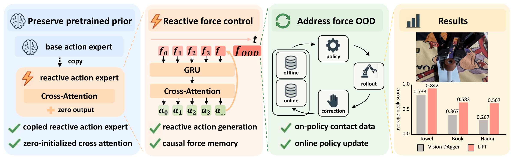

<h2 align="center">LIFT</h2>
<h3 align="center">Never Too Late for Force:<br>Accelerating VLA Post-Training with Reactive Force Injection</h3>

<p align="center">
  🎉 <strong>CoRL 2026 Spotlight (Top 10%)</strong>
</p>

<p align="center">
  <a href="https://y-wng.github.io/">Yi Wang</a><sup>12*</sup>,
  <a href="https://wendichen.me">Wendi Chen</a><sup>12*‡</sup>,
  <a href="https://github.com/nssmd">Zimo Wen</a><sup>14*</sup>,
  <a href="https://hanxue.me">Han Xue</a><sup>1</sup>,
  Xueqi Li<sup>23</sup>,
  <a href="https://virlus.github.io/">Wenye Yu</a><sup>12</sup>,
  <br>
  Zhijie Chen<sup>1</sup>,
  Hao Yang<sup>1</sup>,
  <a href="https://lyuj1998.github.io">Jun Lv</a><sup>15</sup>,
  <a href="https://alvinwen428.github.io">Chuan Wen</a><sup>1†</sup>,
  <a href="https://www.mvig.org">Cewu Lu</a><sup>125†</sup>
  <br>
  <sup>1</sup>Shanghai Jiao Tong University &nbsp;
  <sup>2</sup>Shanghai Innovation Institute
  <br>
  <sup>3</sup>Southern University of Science and Technology &nbsp;
  <sup>4</sup>Zhiyuan College, Shanghai Jiao Tong University
  <br>
  <sup>5</sup>Noematrix Ltd.
  <br>
  <sup>*</sup>Equal contribution &nbsp;
  <sup>‡</sup>Project lead &nbsp;
  <sup>†</sup>Corresponding authors
</p>

<p align="center">
  <a href="https://arxiv.org/abs/2607.14236">📄 Paper</a> &nbsp;·&nbsp;
  <a href="https://lift-policy.github.io/">🌐 Project Page</a>
</p>

**LIFT (Late Reactive Injection of Force for VLA Post-Training)** adds contact
reactivity to pretrained π₀.₅ policies. A copied reactive action expert and
zero-initialized cross-attention inject causal force memory, while online DAgger
combines offline demonstrations with human corrections.

<p align="center">
  
</p>

Built on OpenPI, this repository provides **policy training and model inference**,
not a robot-control or data-collection stack (except the [AR3 deployment](#-rokae-ar3--dm-gripper) of this fork).

## ⚙️ Installation

Use Linux, Python 3.11.8 or newer within the 3.11 series, CUDA-capable NVIDIA GPUs, and `uv`.

```bash
git clone https://github.com/y-wng/LIFT.git
cd LIFT
GIT_LFS_SKIP_SMUDGE=1 uv sync --locked
```

Dependencies are specified in `pyproject.toml` and pinned in `uv.lock`.

## 📚 Offline Training

1. **Prepare data.** Use LeRobot datasets with wrist images (`left_wrist_img`),
   7D `state` and `actions`, and task descriptions. The supplied task presets use
   10 Hz data. Set the dataset and checkpoint roots:

   ```bash
   export HF_LEROBOT_HOME=/path/to/lerobot
   export OPENPI_CHECKPOINT_ROOT=/path/to/checkpoints
   ```

2. **Configure the task.** Set the dataset `repo_id`, initialization
   `weight_loader`, and normalization `assets` in
   [src/openpi/training/config.py](src/openpi/training/config.py).
   The Book preset uses `flexiv/book_insertion_v3_100`, initializes from
   `$OPENPI_CHECKPOINT_ROOT/30000/params`, and reads statistics from
   `$OPENPI_CHECKPOINT_ROOT/30000/assets/flexiv/book_insertion_v3_100/norm_stats.json`.
   To compute statistics for new data, see [scripts/compute_norm_stats.py](scripts/compute_norm_stats.py).

3. **Train the offline π₀.₅ policy.** The Book preset uses two GPUs:

   ```bash
   CUDA_VISIBLE_DEVICES=0,1 uv run python scripts/train.py \
     pi05_iPhoneSingle_book_insertion_v3_100 \
     --exp-name offline \
     --checkpoint-base-dir "$OPENPI_CHECKPOINT_ROOT" \
     --no-wandb-enabled
   ```

   Checkpoints are saved under `<checkpoint-root>/<config>/<exp-name>/<step>/`.
   Task presets and data transforms are in `src/openpi/training/config.py`;
   training overrides and resume instructions are documented in [scripts/train.py](scripts/train.py).

## 🔄 Online DAgger Launchers

The online loop consists of policy inference, human correction, data transfer,
format conversion, and policy updates. The steps below describe this general
workflow; the quoted notes specify our LIFT setup.

1. **Real-world inference.** Run the current policy and connect its predictions
   to the robot's observation and action-execution loop.

   > **LIFT setup:** We deploy on a Flexiv robot arm. Model inference is provided
   > by [scripts/serve_policy.py](scripts/serve_policy.py), with a WebSocket client
   > in [packages/openpi-client](packages/openpi-client/src/openpi_client/websocket_client_policy.py).
   > Robot drivers and action execution are external to this repository.

2. **Human-intervention data collection.** Record corrective actions together
   with images, robot state, force measurements, and intervention labels.

   > **LIFT setup:** We use TDK for human-intervention data collection and save
   > the recordings locally in **NEDF2** format. The TDK collection system is
   > not included in this repository.

3. **Data upload.** Transfer completed episodes from the local collection
   computer to the training server, preserving their directory structure.

   > **LIFT setup:** Local NEDF2 episodes are uploaded to a cloud server before
   > conversion. Upload tooling is deployment-specific and is not bundled here.
   > Publish each episode's `.done` marker only after all files have arrived;
   > the converter also accepts the legacy `.down` marker.

4. **Format conversion.** Convert uploaded recordings into datasets that the
   training loader can consume.

   > **LIFT setup:** On the cloud server,
   > [scripts/nedf2_to_lerobot_incremental_flexiv_tdk.sh](scripts/nedf2_to_lerobot_incremental_flexiv_tdk.sh)
   > watches completed NEDF2 episodes and exports per-episode **LeRobot** datasets.
   > This optional conversion path requires the external `nmx_nedf_api` reader SDK.
   > The following command selects the Book task; other presets are listed in the script.

   ```bash
   SOURCE_DIR=/path/to/uploaded_nedf2 \
   OUTPUT_PATH=/path/to/lerobot_corrections \
   CONFIG_PATH=preprocess_data/configs/book_insertion_v3_online.yaml \
   bash scripts/nedf2_to_lerobot_incremental_flexiv_tdk.sh
   ```

5. **Online post-training.** Mix the new corrections with offline demonstrations,
   train the policy, and use an updated checkpoint for subsequent rollouts.

   > **LIFT setup:** The trainer scans completed LeRobot exports and uses a fixed
   > **1:1 offline:online** mixture. Online LIFT data requires 6D `left_wrench`
   > and `control_flag`; intervention chunks use `control_flag == -1` by default.
   > Set `OPENPI_INTERVENTION_VALUE` if your recordings use a different label.
   > Run training in a separate terminal from the converter, with
   > `OPENPI_LOCAL_LEROBOT_DATA_ROOT` pointing to the converter's `OUTPUT_PATH`.

   ```bash
   export OPENPI_INIT_CHECKPOINT=/path/to/offline_checkpoint/params
   export OPENPI_LOCAL_LEROBOT_DATA_ROOT=/path/to/lerobot_corrections
   bash scripts/train_online_dagger_lerobot_reactive.sh
   ```

Task, GPU, batch-size, data-layout, and resume options are documented in
[scripts/train_online_dagger_lerobot_reactive.sh](scripts/train_online_dagger_lerobot_reactive.sh).
Set `OPENPI_DRY_RUN=1` to preview either launcher without running it.
`OPENPI_ONLINE_REPO_ID` names a disposable output cache,
not an input dataset; keep it separate from source data.

## 🔬 Ablation

Use the same checkpoint and correction data as LIFT. Ratios below are
**offline:online**:

```bash
# Sampling ratio
bash scripts/train_online_dagger_lerobot_reactive_ratio_0to1.sh
bash scripts/train_online_dagger_lerobot_reactive_ratio_1to1.sh
bash scripts/train_online_dagger_lerobot_reactive_ratio_1to2.sh

# Force history: attend only to the first force-memory token
bash scripts/train_online_dagger_lerobot_reactive_no_force_history.sh
```

Ratio launchers require eligible online data before the first training step.
Set `OPENPI_ALLOW_OFFLINE_WARM_START=1` only when an offline warm start is intended.
Fractional batch quotas are carried across batches; sample counts are logged.

The force ablation sets `Pi0Config.use_force_history=False` and restricts
`make_cross_attn_mask` in [src/openpi/models/pi0.py](src/openpi/models/pi0.py); it does not remove force
conditioning. Sampling settings are documented in the corresponding wrappers.

## ⚖️ Baseline

Use the data roots configured above. The original π₀.₅ baseline uses
`OPENPI_INIT_CHECKPOINT`; the residual baseline uses a separate frozen base:

```bash
# Original π₀.₅: vision-only online DAgger
bash scripts/train_online_dagger_lerobot.sh

# Residual policy: frozen π₀.₅ with a trainable correction head
export OPENPI_BASE_INIT_CHECKPOINT="$OPENPI_INIT_CHECKPOINT"
bash scripts/train_online_dagger_lerobot_residual.sh
```

Baseline-specific data requirements, residual checkpoint loading, and target
generation are documented in these two launchers. The residual model is implemented
in [src/openpi/models/residual_policy.py](src/openpi/models/residual_policy.py).

## 🦾 Rokae AR3 + DM Gripper

This fork trains LIFT on the Rokae AR3 with its
[Cartesian impedance controller](https://github.com/Airomantic/ar3_CartesianImpedanceControl)
and the DM tac G2/V3 gripper ([SDK](https://github.com/Airomantic/dmrobotics_Flux_pkg_V1.2.13.1)),
and runs the trained policy on that robot. LeRobot v3.0 recordings are read natively
([src/openpi/data/lerobot_v3.py](src/openpi/data/lerobot_v3.py)); the I/O mapping is in
[src/openpi/policies/ar3_lift_policy.py](src/openpi/policies/ar3_lift_policy.py):

| LIFT input / output | AR3 dataset feature |
| --- | --- |
| base image / wrist image | `observation.images.front` / `observation.images.wrist` |
| `state` (7D) | `observation.tcp_pose` (xyz + rotation) + `observation.gripper_position` (0 = closed … 1000 = open) |
| force sequence (13D, reactive expert) | `observation.tcp_wrench` (6D) + `observation.tau_m` (7 joint torques) |
| `actions` (10 × 7, 10 Hz) | relative TCP pose (xyz + Euler xyz of `inv(T_state) @ T_target`) + gripper target |

**Train** (`pi05_ar3_lift_reactive`, from `pi05_base`, 30k steps, batch 96, H100 GPUs 0–2; options in the header):

```bash
bash scripts/train_ar3_lift_gpu012.sh
```

Several sessions recorded alike (same fps and sensors, any episode length) train as one dataset when listed
`:`-separated in `OPENPI_AR3_REPO_ID`. Every frame is sampled equally, each session keeps its own task prompts and
Tac G2 cache, and the normalization statistics cover all of them under
`assets/<config>/<dir1>+<dir2>/`. A new combination therefore needs a new run (new `OPENPI_EXP_NAME`), not a resume.

**Serve and validate** a checkpoint step directory on the GPU server, replaying recorded frames exactly as the robot
queries the policy (LIFT Algorithm 1: `reactive_replan`, then one `reactive_step` per force reading):

```bash
bash scripts/serve_ar3_lift.sh /data/jiang/train_checkpoints/pi05_ar3_lift_reactive/<exp>/29999
.venv/bin/python scripts/ar3_lift_replay_check.py --port 8000 --episode 0 --num-chunks 5
```

**Run on the robot PC** (ROS 2 Jazzy, domain 111). Forward the policy port with
`ssh -N -L 8000:127.0.0.1:8000 <user>@<gpu-server>`, then:

```bash
./infer_oneclick.sh                                  # impedance controller, gripper service, cameras, tilt, readiness
./infer_oneclick.sh --ready-only --initialize-gripper  # once after gripper power-up (MOVES the fingers)
scripts/run_ar3_lift_robot.sh --check                # controller, cameras and gripper; no motion
scripts/run_ar3_lift_robot.sh --max-chunks 3         # dry run: targets only on preview_command
scripts/run_ar3_lift_robot.sh --execute --move-to-start  # MOVES the arm and gripper
```

The client ([scripts/ar3_lift_robot_client.py](scripts/ar3_lift_robot_client.py)) streams the absolute TCP targets at
100 Hz to the impedance controller with the recording teleoperation's command shaping and commands the gripper
(speed 80, force level 20) over gRPC. It recenters the controller's workspace sphere at the start pose
(`./infer_oneclick.sh` uses a 0.45 m radius; the recorded motions reach 0.43 m) and stops on stale sensors,
tracking errors, controller faults, policy timeouts and Ctrl+C. Closing tabs is not an emergency stop: keep the
robot's hardware stop within reach. The robot Python (`INFER_ROBOT_PYTHON`, default the gripper's `.venv-ros`) also
needs the packages below. The launcher disables user-site packages; installing into the activated model `.venv`
or `~/.local` does not install them into the robot environment:

```bash
PYTHONNOUSERSITE=1 ../V3_Gripper/.venv-ros/bin/python -m pip install 'websockets>=11,<18' msgpack typing_extensions pillow
```

The TCP wrench component order (assumed
Fx, Fy, Fz, Tx, Ty, Tz) still awaits vendor or physical validation.

**VS Code 本机真机调试**：打开本项目，在“运行和调试”中选择
`AR3 LIFT：真机推理（回起点并执行）`，点击绿色三角或按 F5。配置位于
[.vscode/launch.json](.vscode/launch.json)，checkpoint 以对应配置的 `--checkpoint` 为准，GPU 0、ROS domain 111。
每个 Debug 配置的 `args` 都显式包含 `--task=...`；切换任务时修改等号后的整段提示词，
保留为一个 JSON 字符串，并放在参数分隔符 `--` 后。该提示词用于模型预热和每块动作推理；
命令行的 `--prompt` 仍可作为同义参数使用。
“真机推理（回起点并执行）”配置显式设置 `"--max-chunks", "35"`，在 `args` 中修改这个数字即可调节
执行总块数。名义执行时长为 `max_chunks × action_horizon / control_hz`：当前模型每块 10 个动作，
客户端默认 10 Hz，因此 30 块约 30 秒、35 块约 35 秒；实际耗时还包含各块的模型等待时间，
模型加载、预热和回起点发生在执行循环之前。未指定该参数的入口仍默认执行 30 块。
这个参数改变执行多少块，不改变模型每块预测的动作数 `action_horizon`；训练回合采集 30 秒或 35 秒
也不等于每块预测 30 秒或 35 秒，无需为了延长本次执行而修改模型的动作窗口或控制频率。
无需先激活 `.venv`：模型服务使用项目 Python 3.11，机器人客户端使用夹爪 Python 3.12 和 ROS Jazzy。
启动器等待模型服务就绪，复用已有硬件，启动缺少的设备并检查传感器后，执行
`--execute --move-to-start`（机械臂先回到录制项目保存的原点，随后机械臂和夹爪执行模型动作）。
真机调试配置显式使用 `../ar3_CartesianImpedanceControl/config/cartesian_home.json`。
命令行默认读取 `INFER_AR3_WS/config/cartesian_home.json`（未设置时使用上述相邻项目）；
可用 `--home-file` 指定文件，或用互斥的 `--start-pose X Y Z ROLL PITCH YAW` 显式指定目标。
归位使用平滑轨迹，速度不超过 `0.02 m/s`、`0.1 rad/s`，反馈落后时暂停轨迹进度。
路径结束且实测位置误差不超过 `55 mm`、旋转误差不超过 `0.06 rad`，连续保持 `0.3 s` 后，
才允许进入模型动作执行；归位或夹爪打开失败会终止本次推理。归位期间保留原有外力、跟踪和超时保护。
模型预热在机械臂使能前完成；实际执行的首块动作使用归位后的新观测。
可直接按 F5，也可先运行 `bash infer_oneclick.sh` 再按 F5；已有设备会被复用。
`bash infer_oneclick.sh` 本身也可重复执行：保留已运行的阻抗控制器、相机、云台和夹爪服务，
只为缺少的设备开新标签页。所有设备已运行时，在当前终端重新检查完整传感器输入并输出
`PREPARATION READY`。遥操作、其他控制器和正在执行的推理客户端仍会阻止准备。
相机节点发现等待 3 秒，缺少相机时再次扫描；确实缺少一路时只启动缺少的那一路。
客户端与 Orbbec 默认发布器使用可靠图像传输、仅保留最新一帧，图像过期阈值仍为 0.2 秒。
机械臂由相邻的 `../ar3_CartesianImpedanceControl/jazzy.sh` 启动 `cartesian_impedance_node`，
与 `infer_oneclick.sh` 使用同一套控制器；可用 `INFER_AR3_WS` 指定其路径。
夹爪上电后的初始化仍需显式运行上面的 `--ready-only --initialize-gripper` 命令。

另有“检查（复用已启动硬件）”和“预览 3 块”配置。检查入口同时验证模型服务健康状态与机器人输入，
预览入口运行真实模型但只发布预览目标。模型日志在 `logs/ar3_lift_policy_debug_*.log`。
退出调试时清理本次启动的模型服务，硬件服务继续保留；模型进程在启动前绑定调试进程的生命周期，
即使 VS Code 强制结束调试，也会自动结束该模型进程，避免遗留端口和 GPU 占用。
若 8000 端口已有其他服务，启动器会报出冲突；
确认已有服务就是所需模型后，可在 `args` 中的 `--` 之前加入 `--reuse-policy`。

本机手腕 Gemini 305 使用 `outputs/orbbec_wrist_driver/overlay` 中已验证的驱动补丁，
避免系统驱动重复启动 V4L2 视频流后无图像；该本地目录需保留。
`INFER_WRIST_DRIVER_OVERLAY` 可指定其他补丁目录。补丁只应用于手腕相机。
准备流程会读取手腕相机实际帧的 metadata，确认自动曝光和自动白平衡关闭、曝光 `80`、增益 `16`、
白平衡 `4600 K`；复用已运行相机时也会检查。参数不符会报告实际值；收不到有效 metadata 也会停止准备。

可在 [scripts/ar3_lift_robot_client.py](scripts/ar3_lift_robot_client.py) 中设置断点。
真机执行时暂停会触发原有超时保护；恢复调试后应重新启动该推理会话。观察动作处理逻辑优先使用预览配置。
对应的命令行入口是：

```bash
scripts/ar3_lift_debug_python.sh scripts/debug_ar3_lift_robot.py -- --execute --move-to-start \
  --home-file ../ar3_CartesianImpedanceControl/config/cartesian_home.json
```

**Record rollouts and DAgger corrections** (LIFT stage two). `--record-dir DIR` appends every episode the operator
keeps to a LeRobot v3.0 dataset with the offline dataset's features (front/wrist video, TCP pose, gripper opening,
TCP wrench, `tau_m`, the commanded 7D action) and `control_flag` (1 = policy, −1 = human); the robot Python also needs
`pip install pyarrow av`. With `--dagger`, each episode starts at the saved home (as `--move-to-start`) and runs the
policy; pressing the teleoperation clutch hands the arm to the operator at once, and the gripper follows the trigger
once the trigger has matched the fingers' opening
([scripts/ar3_dagger_gripper_teleop.py](scripts/ar3_dagger_gripper_teleop.py)).
Releasing the clutch ends the episode; the terminal then asks whether to save it.

```bash
./infer_oneclick.sh --dagger    # also MessageBridge, Puppetry, the Cartesian teleoperation and the gated gripper
scripts/run_ar3_lift_robot.sh --check --dagger
scripts/run_ar3_lift_robot.sh --execute --dagger --record-dir outputs/ar3_lift_dagger/round1  # MOVES; clutch = takeover
# GPU server (after copying the round's dataset): the offline checkpoint plus every correction dataset so far
bash scripts/train_ar3_lift_dagger_gpu012.sh <offline step dir> /data/jiang/ar3_dagger/round1
```

As in LIFT, training uses only action chunks recorded entirely under human control and samples offline
demonstrations and corrections 1:1 in every batch; serve the result with `scripts/serve_ar3_lift.sh` and repeat
collection and training for several rounds.

In VS Code, `AR3 LIFT：真机推理并录制回合` records policy rollouts to `outputs/ar3_lift_rollouts`. For DAgger, run
`./infer_oneclick.sh --dagger` in a terminal first, then `AR3 LIFT DAgger：检查` and
`AR3 LIFT DAgger：推理+接管纠正采集` (it asks for the dataset directory). Both load the local policy like the
configurations above but use `--hardware skip`: device preparation would refuse the running teleoperation as a
conflicting command source. `AR3 LIFT DAgger：夹爪门控检查` prints the trigger → gripper target mapping without
moving the gripper. The command line equivalent of the collection is:

```bash
scripts/ar3_lift_debug_python.sh scripts/debug_ar3_lift_robot.py --hardware skip -- --execute --dagger \
  --record-dir outputs/ar3_lift_dagger/round1 --home-file ../ar3_CartesianImpedanceControl/config/cartesian_home.json
```

## ✋ muscleVLTA: AR3 + Tac G2 Visuotactile Insertion

muscleVLTA (`pi05_ar3_muscle_vlta`) is the AR3 LIFT policy for plug insertion, where the plug's prongs and the socket
holes leave both camera views once the plug is above the socket. Its reactive expert also reads 1 s of force history
(`sensor_history=10` steps before each chunk) and the Tac G2 hand stream of both fingers
([src/openpi/models/hand_encoder.py](src/openpi/models/hand_encoder.py)):

| muscleVLTA input | AR3 dataset source (`/data/jiang/ar3_eef_forceVisuoTactaile_plugIn`) |
| --- | --- |
| finger indentation maps (2 × 48 × 64) and their change since the previous step | `tactile/episode-*/tactile_depth.sensor_{0,2}.parquet`, frame-aligned by `scripts/build_ar3_tactile_cache.py` |
| finger wrenches (2 × 6D) | `observation.gripper_wrench.sensor_{0,2}` |
| gripper opening (0 = closed … 1000 = open) | `observation.gripper_position` |
| arm force (13D), images, state, actions | as in AR3 LIFT above |

Finger contact is sparse: it appears only while an object is held. Each finger reading therefore passes a learned
contact gate (without contact it collapses to a no-contact embedding; a missing finger uses a separate missing-sensor
embedding), and a GRU fuses both fingers and the gripper opening over time. The arm and hand streams form the reactive
expert's memory under LIFT's causal cross-attention mask, so an action only attends to readings at least
`cross_attention_latency` steps older. Training drops the hand or single fingers (10% each) and adds training-only
losses for the contact gates and for an action-conditioned forward model of the next arm and finger readings.

**Train, serve and validate** (GPU server). The launcher builds the dataset's Tac G2 cache once, then runs
`scripts/train_ar3_lift_gpu012.sh` with its options (GPUs 0–2 by default; the batch of 96 must divide by the GPU count):

```bash
OPENPI_EXP_NAME=muscle_vlta_30k OPENPI_NUM_TRAIN_STEPS=30000 bash scripts/train_ar3_muscle_vlta.sh
# other GPUs: OPENPI_CUDA_VISIBLE_DEVICES=4,5,6,7; continue a run: OPENPI_RESUME=1 with the same OPENPI_EXP_NAME
# 30 s and 35 s sessions together (one Tac G2 cache each):
#   OPENPI_AR3_REPO_ID=/data/jiang/ar3_eef_forceVisuoTactaile_plugIn:/data/jiang/ar3_eef_forceVisuoTactaile_plugIn_35
PLUG_IN="plug the two-pronged white charger on the table into the white socket, don't bump your fingers into other objects"
OPENPI_CONFIG_NAME=pi05_ar3_muscle_vlta OPENPI_PROMPT="$PLUG_IN" \
  bash scripts/serve_ar3_lift.sh /data/jiang/train_checkpoints/pi05_ar3_muscle_vlta/muscle_vlta_30k/29999
.venv/bin/python scripts/ar3_lift_replay_check.py --port 8000 --dataset /data/jiang/ar3_eef_forceVisuoTactaile_plugIn \
  --episode 0 --num-chunks 5 --start-frame 180   # frames with the plug held; prints the Tac G2 peaks per chunk
```

**Run on the robot PC.** The client reads the sensor layout from the server metadata and needs no extra flag; the
policy prompt must be the insertion task (the defaults are the unplugging task). `--tactile` starts the Tac G2 pipeline
of the recordings (the lerobot `oneClick.sh`): the sensor server on the gripper host
(`~/dmrobotics_Flux_pkg_V1.2.13.1/dmrobotics_Flux_pkg/sensor_server/grpc_server.py`, ports 50051/50052) before the
gripper service, then the local `scripts/ar3_tactile_bridge.py --preview` of the lerobot project
(`INFER_LEROBOT_DIR`, default `../lerobot_89236e_muscleVLTA_eef`, with its `.venv-ar3`), and waits for the depth and
wrench of both fingers:

```bash
./infer_oneclick.sh --tactile
PLUG_IN="plug the two-pronged white charger on the table into the white socket, don't bump your fingers into other objects"
scripts/run_ar3_lift_robot.sh --check --prompt "$PLUG_IN"
scripts/run_ar3_lift_robot.sh --max-chunks 3 --prompt "$PLUG_IN"                 # dry run
scripts/run_ar3_lift_robot.sh --execute --move-to-start --prompt "$PLUG_IN"      # MOVES the arm and gripper
```

A missing finger reading at start-up stops the client; later dropouts are logged and the policy continues with the
missing-sensor embedding it was trained with. `--record-dir` and `--dagger` do not record the Tac G2 streams yet: their
episodes would train muscleVLTA with the fingers missing.

**VS Code**：先把检查点步目录复制到 `infer_checkpoint/muscle_vlta_29999`（含 `params/` 与 `assets/`），
再选择 `muscleVLTA：插充电头真机推理（Tac G2，回起点并执行）`、`muscleVLTA：预览 3 块（Tac G2，不执行机械臂和夹爪动作）`
或 `muscleVLTA：检查（Tac G2，复用已启动硬件）`。前两项在 `--` 之前带 `--tactile`，启动器只补启缺少的
传感服务和触觉桥，并检查两指的深度图与六维力；检查项使用 `--hardware skip`，需先运行 `./infer_oneclick.sh --tactile`。
三项均设置 `OPENPI_CONFIG_NAME=pi05_ar3_muscle_vlta`，并在 `--` 之后用 `--task=` 指定插入任务提示词。

**VS Code 训练调试**：`muscleVLTA 训练调试：2 卡 FSDP（同批量训练）` 直接运行 `scripts/train.py`，配置、数据、初始权重和
学习率同 `scripts/train_ar3_muscle_vlta.sh`，改为 batch 32、`--num-workers 0`（数据集和 transforms 中的断点才会停下）、
每步打印 loss；检查点写入 `/data/jiang/train_checkpoints_debug`，`--overwrite` 每次只清空该调试实验。只有一张空闲卡时选
`muscleVLTA 训练调试：1 卡（关 EMA，batch 4）`。启动时输入空闲 GPU；数据集在配置的 `OPENPI_AR3_REPO_ID` 中修改，
这组数据须先用启动脚本训练过一次（已有 Tac G2 缓存和 norm stats）。

## 🙏 Acknowledgements

LIFT is built on [OpenPI (π₀/π₀.₅)](https://github.com/Physical-Intelligence/openpi).
We also thank [ImplicitRDP](https://github.com/Chen-Wendi/ImplicitRDP),
[CR-DAgger](https://github.com/yifan-hou/cr-dagger), and
[RoboPocket](https://robopocket.github.io/) for their inspiring work on force-aware
policies and interactive policy learning, and for sharing their research with
the community.

## 🔗 Citation

If you find LIFT useful in your research, please consider citing our paper:

```bibtex
@article{wang2026lift,
  title   = {Never Too Late for Force: Accelerating {VLA} Post-Training with Reactive Force Injection},
  author  = {Wang, Yi and Chen, Wendi and Wen, Zimo and Xue, Han and Li, Xueqi
             and Yu, Wenye and Chen, Zhijie and Yang, Hao and Lv, Jun
             and Wen, Chuan and Lu, Cewu},
  journal = {arXiv preprint arXiv:2607.14236},
  year    = {2026},
  url     = {https://arxiv.org/abs/2607.14236}
}
```
